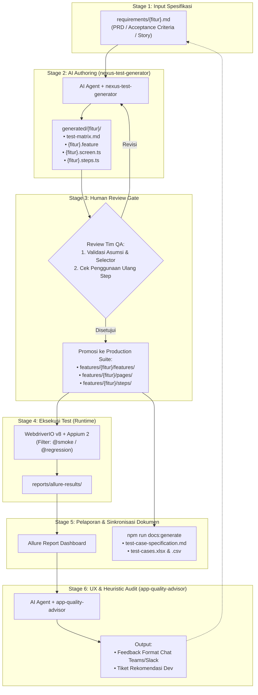

# Kotakin Mobile Automation Framework 🚀

End-to-End Mobile Test Automation Framework untuk **Kotakin Android App** (`com.bmolab.kotakin`), dibangun menggunakan **WebdriverIO v8**, **Appium 2**, **Cucumber BDD**, **TypeScript**, dan **Allure Reports**.

[](https://github.com/fraharjo/kotakin-mobile-automation/actions)
[](https://developer.android.com/)
[](https://webdriver.io/)
[](https://appium.io/)
[](https://cucumber.io/)
[](https://allurereport.org/)
[](LICENSE)

---

## ⚡ Quick Start (4 Langkah Mudah)

```bash
# 1. Clone repository
git clone https://github.com/fraharjo/kotakin-mobile-automation.git
cd kotakin-mobile-automation

# 2. Pasang dependensi & siapkan konfigurasi environment
npm install
cp .env.example .env

# 3. Unduh APK Kotakin dari website pengembang resmi & letakkan di folder apps/
# Link: https://bmolab.web.id/kotakin -> simpan sebagai apps/kotakin.apk

# 4. Pastikan Android Emulator sudah aktif, lalu jalankan smoke test:
adb devices  # Pastikan emulator terdeteksi (Appium otomatis di-start oleh WDIO)
npm run test:smoke
```

---

## 📑 Daftar Isi
1. [Arsitektur & Siklus Hidup Pengujian](#-arsitektur--siklus-hidup-pengujian-bdd--ai-skills)
2. [Cakupan Test Suite](#-cakupan-test-suite)
3. [Taksonomi Tag Pengujian](#-taksonomi-tag-pengujian)
4. [Struktur Direktori Project](#-struktur-direktori-project)
5. [Prasyarat Sistem & Konfigurasi](#-prasyarat-sistem--konfigurasi)
6. [Menjalankan Pengujian](#-menjalankan-pengujian)
7. [Dokumentasi Otomatis (Single Source of Truth)](#-dokumentasi-otomatis-single-source-of-truth)
8. [Pelaporan Interaktif (Allure Report)](#-pelaporan-interaktif-allure-report)
9. [Continuous Integration (GitHub Actions)](#-continuous-integration-github-actions)
10. [Panduan Integrasi AI Skill](#-panduan-integrasi-ai-skill)
11. [Troubleshooting & FAQ](#-troubleshooting--faq)
12. [Cara Menambah Test Baru](#-cara-menambah-test-baru)
13. [Credits & Lisensi](#-credits--lisensi)

---

## 🔄 Arsitektur & Siklus Hidup Pengujian (BDD + AI Skills)

> [!NOTE]
> **Pemisahan Authoring vs Runtime:** AI Skills (`nexus-test-generator` dan `app-quality-advisor`) adalah panduan perancangan skenario pada tahap *Authoring*, bukan bagian dari runtime eksekusi test. WebdriverIO hanya mengeksekusi kode yang sudah disetujui lewat tahap *Human Review Gate*.



---

## 📊 Cakupan Test Suite

Total **49 Skenario BDD** terotomatisasi secara penuh melintasi 5 modul aplikasi Kotakin:

| Modul Aplikasi | Total Skenario | Requirement Key | Fokus Pengujian |
| :--- | :---: | :---: | :--- |
| **Box Creation & Management** | 26 | `@REQ-KTK-201` | Alur CRUD, batas input (1 & 50 karakter), spasi kosong, sanitasi script, pencarian regex, backgrounding |
| **Item Management Inside Box** | 11 | `@REQ-KTK-401` | Stepper jumlah (+/-), tangkapan kamera, karakter emoji, deskripsi 250 karakter, validasi negatif |
| **Application Settings & Localization** | 5 | `@REQ-KTK-301` | Mode dwi-bahasa (Inggris & Indonesia), versi build, cadangkan & pulihkan data |
| **Onboarding & Walkthrough** | 4 | `@REQ-KTK-101` | Panduan slide, tombol lewati panduan, navigasi kembali, reset status aplikasi |
| **Physical QR Code Scanner** | 3 | `@REQ-KTK-501` | Jendela bidik scanner, penolakan izin kamera, tombol kembali aman |

---

## 🏷️ Taksonomi Tag Pengujian

Tag Gherkin digunakan untuk mengatur keterlacakan dan eksekusi pengujian:

| Kategori | Tag | Deskripsi & Contoh Penggunaan |
| :--- | :--- | :--- |
| **Traceability** | `@REQ-KTK-xxx` | Memetakan skenario langsung ke dokumen kebutuhan fitur |
| **Eksekusi** | `@automated` | Skenario yang siap dijalankan oleh test runner Appium |
| | `@manual` | Skenario verifikasi manual (otomatis dikecualikan oleh test runner) |
| **Prioritas** | `@smoke` | Alur kritis aplikasi P0, wajib lulus sebelum rilis |
| | `@regression` | Rangkaian lengkap verifikasi fitur secara menyeluruh (P1) |
| **Tipe Uji** | `@functional` | Verifikasi logika bisnis positif dan alur interaksi pengguna |
| | `@negative` | Validasi penolakan input tidak sah dan form validation |
| | `@bva` | Boundary Value Analysis (batas minimum 1 karakter, batas maksimum 50/250 karakter) |
| | `@security` | Uji sanitasi karakter dan injeksi script |
| | `@permission` | Pengujian penolakan dan pemberian izin kamera perangkat |
| | `@lifecycle` | Pengujian saat aplikasi masuk background dan dibuka kembali |
| | `@favorite` | Verifikasi toggle bookmark / favorite |
| **Modul Fitur** | `@feature-box` | Filter pengujian khusus modul Box Management |
| | `@feature-item` | Filter pengujian khusus modul Item Management |
| | `@feature-settings` | Filter pengujian khusus modul Application Settings & i18n |
| | `@feature-onboarding` | Filter pengujian khusus modul Onboarding Walkthrough |
| | `@feature-scanner` | Filter pengujian khusus modul QR Code Scanner |
| **Platform** | `@android` | Penanda pengujian ditujukan untuk platform Android |

---

## 📁 Struktur Direktori Project

Framework ini mengusung arsitektur **Feature-First (Modular Domain Architecture)**:

```text
kotakin-mobile-automation/
├── .agents/skills/                 # AI Assistant Skills (Antigravity & Cursor)
│   ├── nexus-test-generator/       # Generator BDD Gherkin & Screen Objects
│   └── app-quality-advisor/        # Auditor Kualitas UX & Heuristik
├── .claude/skills/                 # Symlink kompatibilitas untuk Claude Code
├── .github/workflows/              # CI/CD Workflows (GitHub Actions)
│   └── test-runner.yml             # Dual-mode pipeline (Typecheck & Emulator)
├── apps/                           # Wadah file APK lokal (diabaikan oleh git)
│   └── README.md                   # Petunjuk sumber resmi APK dari developer
├── docs/                           # Dokumentasi hasil generate (Single Source of Truth)
│   ├── test-case-specification.md  # Spesifikasi lengkap 49 skenario + RTM
│   ├── test-cases.xlsx             # Format spreadsheet Microsoft Excel
│   └── test-cases.csv              # Format Universal CSV
├── features/                       # Production Test Suite aktif
│   ├── box/
│   │   ├── features/box.feature    # 21 Skenario BDD fitur Box
│   │   ├── pages/box.screen.ts     # Screen Object fitur Box
│   │   ├── steps/box.steps.ts      # Step Definitions fitur Box
│   │   └── requirements/box-prd.md # Dokumen spesifikasi acuan fitur Box
│   ├── item/                       # Modul Item (11 Skenario)
│   ├── onboarding/                 # Modul Onboarding (4 Skenario)
│   ├── scanner/                    # Modul QR Scanner (3 Skenario)
│   └── settings/                   # Modul Pengaturan (5 Skenario)
├── generated/                      # Staging area hasil generate AI (sebelum review)
│   └── README.md                   # Prosedur verifikasi dan promosi kode
├── requirements/                   # Dokumen input spesifikasi fitur baru (PRD/AC)
│   └── README.md                   # Format penulisan kebutuhan fitur
├── reports/                        # Hasil eksekusi Allure (diabaikan oleh git)
│   └── allure-results/             # Tempat keluaran data Allure (.gitkeep)
├── scripts/                        # Script penunjang otomasi
│   └── generate-docs.ts            # Sinkronisasi dokumen dari file .feature
├── shared/                         # Komponen reusable lintas modul
│   ├── config/env.config.ts        # Konfigurasi variabel lingkungan
│   ├── constants/i18n.ts           # Kamus dwi-bahasa (EN / ID)
│   ├── pages/base.screen.ts        # Base Screen Object (Universal Locator)
│   └── steps/common.steps.ts       # Langkah bersama (Given, Background)
├── wdio.android.conf.ts            # Konfigurasi Appium Android & Hooks
├── wdio.shared.conf.ts             # Konfigurasi utama WebdriverIO & Allure
├── .env.example                    # Template konfigurasi lokal
├── LICENSE                         # Lisensi framework (MIT)
└── package.json                    # Dependensi dan script runner
```

---

## 🛠️ Prasyarat Sistem & Konfigurasi

### 1. Kebutuhan Perangkat Lunak
* **Node.js:** Versi 20 LTS atau 22 LTS (direkomendasikan, engines >= 18.0.0)
* **Java JDK:** Versi 11 atau 17 (pastikan `JAVA_HOME` terkonfigurasi)
* **Android SDK:** Tersedia Android Emulator dengan API Level 33
* **Appium 2:** Terpasang dengan driver `uiautomator2` (`appium driver install uiautomator2`)

### 2. Konfigurasi Lingkungan (`.env`)
Salin file template `.env.example` ke `.env`:
```bash
cp .env.example .env
```

Nilai bawaan file `.env`:
```ini
APPIUM_HOST=127.0.0.1
APPIUM_PORT=4723
ANDROID_DEVICE_NAME=Android Emulator
ANDROID_PLATFORM_VERSION=13.0
ANDROID_APP_PATH=./apps/kotakin.apk
ANDROID_APP_ID=com.bmolab.kotakin
```

---

## 📥 Sumber Resmi File APK Kotakin

Sesuai arahan pengembang asli Kotakin (**BmoLab**), file aplikasi tidak disertakan di dalam repository ini. Silakan peroleh APK resmi melalui tautan pengembang:

* 🌐 **Website Resmi:** 👉 [https://bmolab.web.id/kotakin](https://bmolab.web.id/kotakin)
* 🧪 **Program Pengujian:** 👉 [Gabung Closed Testing](https://bmolab.web.id/kotakin/join)
* ✉️ **Email Pengembang:** `bmo.techdev@gmail.com`

Letakkan file yang telah diunduh pada lokasi:
```text
apps/kotakin.apk
```
*(Lokasi ini sudah tercatat di `.gitignore` sehingga tidak akan terunggah ke Git).*

---

## 🚀 Menjalankan Pengujian

```bash
# Menjalankan seluruh pengujian otomatis
npm run test:android

# Menjalankan skenario prioritas tinggi (Smoke Test P0)
npm run test:smoke

# Menjalankan seluruh rangkaian regresi (Regression Suite P1)
npm run test:regression

# Menjalankan per modul fitur tertentu
npm run test:feature:box
npm run test:feature:item
npm run test:feature:settings
npm run test:feature:onboarding
npm run test:feature:scanner
```

---

## 📑 Dokumentasi Otomatis (Single Source of Truth)

Dokumentasi spesifikasi pengujian dan matriks keterlacakan (*Requirements Traceability Matrix / RTM*) diekstrak langsung dari file `.feature`:

```bash
npm run docs:generate
```

Hasil pembuatan dokumen akan langsung diperbarui ke:
* 📄 **Spesifikasi Lengkap:** [docs/test-case-specification.md](docs/test-case-specification.md)
* 📊 **File Excel:** [docs/test-cases.xlsx](docs/test-cases.xlsx)
* 📝 **File CSV:** [docs/test-cases.csv](docs/test-cases.csv)

---

## 📊 Pelaporan Interaktif (Allure Report)

Setelah pengujian selesai, buka laporan interaktif di peramban:

```bash
npm run report:open
```

Atau bangun ulang file laporan HTML secara manual:
```bash
npm run report:generate
```

---

## 🤖 Continuous Integration (GitHub Actions)

Alur integrasi berkelanjutan didefinisikan pada [.github/workflows/test-runner.yml](.github/workflows/test-runner.yml):

1. **Pemeriksaan Kualitas Kode Otomatis (Setiap Push & PR):**
   * Menjalankan kompilasi TypeScript (`npm run typecheck`) pada runner `ubuntu-latest` dengan Node 22 LTS untuk memastikan seluruh step definition dan Screen Object bebas dari kesalahan tipe dalam ~30 detik.
2. **Eksekusi Android Emulator (On-Demand / Manual Trigger):**
   * Dipicu secara manual melalui tab **Actions ➡️ Kotakin Mobile E2E Automation ➡️ Run workflow**.
   * Dijalankan pada runner `ubuntu-latest` dengan akselerasi perangkat keras KVM (`reactivecircus/android-emulator-runner`).
   * Karena file binary APK tidak disimpan di dalam Git, pengguna memasukkan parameter `apk_url` yang valid saat memicu workflow.
   * Laporan Allure HTML otomatis digenerate dan diunggah sebagai artefak run (`allure-report-html`).

---

## 🧠 Panduan Integrasi AI Skill

Folder [.agents/skills/](.agents/skills/) memuat instruksi kecerdasan buatan untuk membantu perancangan dan audit aplikasi:

* **`nexus-test-generator`:** Merancang skenario Gherkin BDD, Screen Object, dan Step Definition berdasarkan dokumen kebutuhan baru di `requirements/`.
* **`app-quality-advisor`:** Mengaudit alur UX, validasi formulir, dan potensi kesalahan heuristik aplikasi mobile pasca eksekusi pengujian.

Untuk pengguna **Claude Code**, folder [.claude/skills/](.claude/skills/) sudah disiapkan sebagai tautan simbolik (*symlink*) langsung ke `.agents/skills/`.  
*(Catatan pengguna Windows: pastikan `git config core.symlinks true` atau salin isi folder secara manual bila fitur symlink dinonaktifkan di sistem operasi).*

---

## 🔧 Troubleshooting & FAQ

#### 1. Pesan kesalahan `The application at '.../apps/kotakin.apk' does not exist`
Penyebab: File APK belum diletakkan di folder tujuan.  
**Solusi:** Unduh file APK resmi dari [https://bmolab.web.id/kotakin](https://bmolab.web.id/kotakin), lalu letakkan di path `apps/kotakin.apk`. Bila menggunakan nama atau path berbeda, sesuaikan variabel `ANDROID_APP_PATH` pada file `.env`.

#### 2. Perangkat emulator tidak terdeteksi saat menjalankan test
Pastikan Android Emulator sudah menyala dan terdeteksi oleh Android Debug Bridge:
```bash
adb devices
```
Bila daftar perangkat kosong, buka Android Studio Virtual Device Manager dan luncurkan emulator terlebih dahulu. (WebdriverIO secara otomatis menangani startup Appium Server via `@wdio/appium-service`).

#### 3. Pesan kesalahan `The driver 'uiautomator2' is not installed`
Pasang driver Appium yang dibutuhkan melalui terminal:
```bash
appium driver install uiautomator2
```

#### 4. Kesalahan `JAVA_HOME is not set`
Pastikan variabel lingkungan `JAVA_HOME` mengarah ke instalasi Java JDK (versi 11 atau 17):
```bash
# Contoh konfigurasi di macOS zsh (~/.zshrc)
export JAVA_HOME=$(/usr/libexec/java_home -v 17)
```

---

## ➕ Cara Menambah Test Baru

1. **Siapkan Dokumen:** Buat file kebutuhan baru di `requirements/{nama-fitur}.md`.
2. **Gunakan Skill Authoring:** Minta AI Agent membuat draf dengan `nexus-test-generator` ke `generated/{nama-fitur}/`.
3. **Review & Promosikan:** Periksa selector elemen UI aktual, lalu pindahkan file yang sudah divalidasi ke dalam folder `features/{nama-fitur}/`.
4. **Perbarui Dokumen:** Jalankan `npm run docs:generate` untuk menyinkronkan seluruh dokumen spesifikasi dan RTM secara otomatis.

---

## 🙏 Credits & Lisensi

* **Aplikasi Kotakin:** Dibuat dan dikembangkan oleh **Bimo Ichmu** (**BmoLab**). Hak cipta dan kepemilikan aplikasi sepenuhnya milik pengembang aslinya. Informasi selengkapnya dapat diakses di [https://bmolab.web.id/kotakin](https://bmolab.web.id/kotakin).
* **Test Automation Framework:** Didistribusikan di bawah lisensi [MIT](LICENSE). Lisensi ini berlaku untuk seluruh kode framework otomasi pengujian di repository ini.
