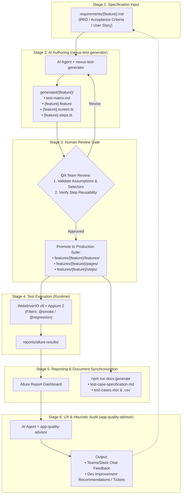

# Kotakin Mobile Automation Framework 🚀

End-to-End Mobile Test Automation Framework for the **Kotakin Android App** (`com.bmolab.kotakin`), built using **WebdriverIO v8**, **Appium 2**, **Cucumber BDD**, **TypeScript**, and **Allure Reports**.

[](https://github.com/fraharjo/kotakin-mobile-automation/actions)
[](https://developer.android.com/)
[](https://webdriver.io/)
[](https://appium.io/)
[](https://cucumber.io/)
[](https://allurereport.org/)
[](LICENSE)

---

## ⚡ Quick Start (4 Easy Steps)

```bash
# 1. Clone repository
git clone https://github.com/fraharjo/kotakin-mobile-automation.git
cd kotakin-mobile-automation

# 2. Install dependencies & set up environment configuration
npm install
cp .env.example .env

# 3. Download the Kotakin APK from the official developer website & place it in the apps/ directory
# Link: https://bmolab.web.id/kotakin -> save as apps/kotakin.apk

# 4. Ensure an Android Emulator is running, then run the smoke tests:
adb devices  # Ensure emulator is detected (Appium is automatically managed by WDIO)
npm run test:smoke
```

---

## 📑 Table of Contents
1. [Architecture & Test Lifecycle (BDD + AI Skills)](#-architecture--test-lifecycle-bdd--ai-skills)
   - [End-to-End Workflow: From Requirement to Running Test](#-end-to-end-workflow-from-requirement-to-running-test)
2. [Test Suite Coverage](#-test-suite-coverage)
3. [Test Tag Taxonomy](#-test-tag-taxonomy)
4. [Project Directory Structure](#-project-directory-structure)
5. [System Prerequisites & Configuration](#-system-prerequisites--configuration)
6. [Official Kotakin APK Source](#-official-kotakin-apk-source)
7. [Running Tests](#-running-tests)
8. [Automated Documentation (Single Source of Truth)](#-automated-documentation-single-source-of-truth)
9. [Interactive Reporting (Allure Report)](#-interactive-reporting-allure-report)
10. [Continuous Integration (GitHub Actions)](#-continuous-integration-github-actions)
11. [Manual QA Execution Dashboard](#-manual-qa-execution-dashboard)
12. [AI Skill Integration Guide](#-ai-skill-integration-guide)
13. [Troubleshooting & FAQ](#-troubleshooting--faq)
14. [How to Add New Tests](#-how-to-add-new-tests)
15. [Credits & License](#-credits--license)

---

## 🔄 Architecture & Test Lifecycle (BDD + AI Skills)

> [!NOTE]
> **Authoring vs. Runtime Separation:** AI Skills (`nexus-test-generator` and `app-quality-advisor`) serve as scenario design guidelines during the *Authoring* phase, and are not part of test runtime execution. WebdriverIO only executes code that has been reviewed and approved via the *Human Review Gate*.



---

## 🧭 End-to-End Workflow: From Requirement to Running Test

You have a Jira ticket, a Figma design, and (optionally) your own manual test cases in a doc/Excel sheet. Here is the path to automated tests:

| # | Step | What you do | Output |
| :-: | :--- | :--- | :--- |
| 0 | **Setup (once)** | `npm install`, `cp .env.example .env`, put `kotakin.apk` in `apps/`, start an emulator (`adb devices`), run `npm run test:smoke` | Working environment |
| 1 | **Gather inputs (Frictionless)** | Put any raw requirement files in `requirements/inputs/{feature}/` (Jira notes `.txt`, Excel `.xlsx/.csv`, Word `.docx`, PDF, Figma screenshots `.png`) | Raw inputs in folder |
| 2 | **Requirement Normalization** | Prompt the agent: *"Design tests from requirements/inputs/{feature}"*. The agent asks questions **one by one** if ambiguous, extracts ACs, and normalizes into `requirements/{feature}.md` | Normalized PRD & Q&A |
| 3 | **Prompt the agent** | Use the template in [docs/qa-prompt-guide.md](docs/qa-prompt-guide.md) (include your manual test cases for gap comparison) | Requirement analysis + open questions |
| 4 | **Review the matrix** | Answer open questions, correct assumptions, approve the coverage matrix | Approved plan |
| 5 | **Draft generated** | Agent writes `generated/{feature}/` (matrix, feature, screen, steps) | Draft files |
| 6 | **Human gate** | Verify selectors against the real app (`adb shell uiautomator dump` or Appium Inspector), tags, step reuse | Validated draft |
| 7 | **Promote** | Move files into `features/{feature}/`, fix imports, add `test:feature:{feature}` to `package.json` | Production suite |
| 8 | **Run automated tests** | `npm run typecheck`, `npm run lint:tags`, `npm run test:feature:{feature}`, `npm run test:smoke`, `npm run report` | Allure report |
| 8b | **Execute manual tests** | For scenarios tagged with `@manual`, run `npm run test:manual:dashboard` (Web UI to set Pass/Fail/Blocked, link Jira bugs, and attach screenshot evidence) | `reports/manual-results/` |
| 9 | **Sync docs** | `npm run docs:generate` | Updated spec, CSV and XLSX |
| 10 | **UX audit (optional)** | Ask the agent to use `app-quality-advisor` with screenshots or Allure results | Findings, chat draft, Jira draft |

> [!IMPORTANT]
> Every scenario needs `@automated` (or `@manual`), `@feature-{module}`, and a runner tag (`@smoke` or `@regression`). A scenario missing any of them is silently skipped by the runner.

> [!NOTE]
> The agent cannot read Jira or Figma by itself unless a connector is installed. Paste the ticket text and attach Figma screenshots otherwise. It will not invent content from a ticket title.

---

## 📊 Test Suite Coverage

Total **49 fully automated BDD scenarios** across 5 modules of the Kotakin application:

| Application Module | Total Scenarios | Requirement Key | Test Focus |
| :--- | :---: | :---: | :--- |
| **Box Creation & Management** | 26 | `@REQ-KTK-201` | Full CRUD flows, boundary limits (1 & 50 chars), whitespace validation, script sanitization, regex search, app backgrounding |
| **Item Management Inside Box** | 11 | `@REQ-KTK-401` | Quantity steppers (+/-), camera capture, emoji support, 250-character descriptions, negative validations |
| **Application Settings & Localization** | 5 | `@REQ-KTK-301` | Bilingual mode (English & Indonesian), build version, data backup & restore |
| **Onboarding & Walkthrough** | 4 | `@REQ-KTK-101` | Slide guide, skip walkthrough button, back navigation, app reset state |
| **Physical QR Code Scanner** | 3 | `@REQ-KTK-501` | Scanner viewfinder, camera permission denial, safe back button navigation |

---

## 🏷️ Test Tag Taxonomy

Gherkin tags are used to organize traceability and test execution:

| Category | Tag | Description & Usage Example |
| :--- | :--- | :--- |
| **Traceability** | `@REQ-KTK-xxx` | Maps scenarios directly to requirement documentation |
| **Execution** | `@automated` | Scenarios ready for execution by the Appium test runner |
| | `@manual` | Manual verification scenarios (automatically excluded by the test runner) |
| **Traceability** | `@AC-xx` | Maps a scenario to an Acceptance Criterion (e.g. `@AC-01`) |
| | `@JIRA-<KEY>` | Maps a scenario to its Jira issue (e.g. `@JIRA-KTK-101`) |
| **Priority** | `@smoke` | P0 critical application path, must pass before any release |
| | `@regression` | Full comprehensive regression test suite (P1) |
| **Risk Level** | `@p0` | Critical path. Always paired with `@smoke` |
| | `@p1` | Main regression flows. Always paired with `@regression` |
| | `@p2` | Edge-case / stress. Always paired with `@regression` |
| **Test Type** | `@functional` | Positive business logic verification and user interaction flows |
| | `@negative` | Invalid input rejection and form validation checks |
| | `@bva` | Boundary Value Analysis (minimum 1 character, maximum 50/250 characters) |
| | `@security` | Character sanitization and script injection tests |
| | `@permission` | Device camera permission denial and grant handling |
| | `@lifecycle` | App backgrounding and resumption lifecycle tests |
| | `@favorite` | Bookmark / favorite toggle verification |
| **Feature Module** | `@feature-box` | Filter tests for Box Management module |
| | `@feature-item` | Filter tests for Item Management module |
| | `@feature-settings` | Filter tests for Application Settings & i18n module |
| | `@feature-onboarding` | Filter tests for Onboarding Walkthrough module |
| | `@feature-scanner` | Filter tests for QR Code Scanner module |
| **Platform** | `@android` | Designates tests targeting the Android platform |

> **Note:** npm scripts filter on `@smoke`, `@regression`, `@automated`, `@manual` and `@feature-*`. `@p0/@p1/@p2` express risk and are not used in runner filters, so always add the paired runner tag (`@p0`→`@smoke`, `@p1`/`@p2`→`@regression`).

---

## 📁 Project Directory Structure

This framework adheres to a **Feature-First (Modular Domain Architecture)** pattern:

```text
kotakin-mobile-automation/
├── .agents/skills/                 # AI Assistant Skills (Antigravity & Cursor)
│   ├── nexus-test-generator/       # BDD Gherkin & Screen Objects Generator
│   └── app-quality-advisor/        # UX Quality & Heuristic Auditor
├── .claude/skills/                 # Compatibility symlink for Claude Code
├── .github/workflows/              # CI/CD Workflows (GitHub Actions)
│   └── test-runner.yml             # Dual-mode pipeline (Typecheck & Emulator)
├── apps/                           # Local APK binary storage (ignored by git)
│   └── README.md                   # Instructions for obtaining official APK
├── docs/                           # Generated documentation (Single Source of Truth)
│   ├── test-case-specification.md  # Complete 49 scenarios specification + RTM
│   ├── test-cases.xlsx             # Microsoft Excel spreadsheet format
│   └── test-cases.csv              # Universal CSV format
├── features/                       # Active Production Test Suite
│   ├── box/
│   │   ├── features/box.feature    # 21 BDD scenarios for Box feature
│   │   ├── pages/box.screen.ts     # Screen Object for Box feature
│   │   ├── steps/box.steps.ts      # Step Definitions for Box feature
│   │   └── requirements/box-prd.md # Reference specification document for Box
│   ├── item/                       # Item Module (11 Scenarios)
│   ├── onboarding/                 # Onboarding Module (4 Scenarios)
│   ├── scanner/                    # QR Scanner Module (3 Scenarios)
│   └── settings/                   # Settings Module (5 Scenarios)
├── generated/                      # Staging area for AI-generated drafts (pre-review)
│   └── README.md                   # Code verification and promotion procedure
├── requirements/                   # Input specification documents for new features (PRD/AC)
│   └── README.md                   # Feature requirement writing guidelines
├── reports/                        # Allure execution outputs (ignored by git)
│   └── allure-results/             # Allure raw output directory (.gitkeep)
├── scripts/                        # Automation support scripts
│   └── generate-docs.ts            # Documentation sync script from .feature files
├── shared/                         # Cross-module reusable components
│   ├── config/env.config.ts        # Environment variable configuration
│   ├── constants/i18n.ts           # Bilingual dictionary (EN / ID)
│   ├── pages/base.screen.ts        # Base Screen Object (Universal Locator)
│   └── steps/common.steps.ts       # Shared steps (Given, Background)
├── wdio.android.conf.ts            # Appium Android configuration & hooks
├── wdio.shared.conf.ts             # WebdriverIO base configuration & Allure setup
├── .env.example                    # Local configuration template
├── LICENSE                         # Framework license (MIT)
└── package.json                    # Dependencies and runner scripts
```

---

## 🛠️ System Prerequisites & Configuration

### 1. Software Requirements
* **Node.js:** Version 20 LTS or 22 LTS (recommended, engines >= 18.0.0)
* **Java JDK:** Version 11 or 17 (ensure `JAVA_HOME` is configured)
* **Android SDK:** Configured Android Emulator with API Level 33
* **Appium 2:** Installed with the `uiautomator2` driver (`appium driver install uiautomator2`)

### 2. Environment Configuration (`.env`)
Copy the `.env.example` template file to `.env`:
```bash
cp .env.example .env
```

Default values in `.env`:
```ini
APPIUM_HOST=127.0.0.1
APPIUM_PORT=4723
ANDROID_DEVICE_NAME=Android Emulator
ANDROID_PLATFORM_VERSION=13.0
ANDROID_APP_PATH=./apps/kotakin.apk
ANDROID_APP_ID=com.bmolab.kotakin
```

---

## 📥 Official Kotakin APK Source

In accordance with guidelines from the official Kotakin developer (**BmoLab**), binary application files are not hosted in this repository. Please obtain the official APK directly via the developer channels:

* 🌐 **Official Website:** 👉 [https://bmolab.web.id/kotakin](https://bmolab.web.id/kotakin)
* 🧪 **Testing Program:** 👉 [Join Closed Testing](https://bmolab.web.id/kotakin/join)
* ✉️ **Developer Email:** `bmo.techdev@gmail.com`

Place the downloaded file at:
```text
apps/kotakin.apk
```
*(This path is listed in `.gitignore` to prevent committing binaries into Git).*

---

## 🚀 Running Tests

```bash
# Run all automated tests
npm run test:android

# Run high-priority critical path tests (Smoke Test P0)
npm run test:smoke

# Run the complete regression test suite (Regression Suite P1)
npm run test:regression

# Run specific feature modules
npm run test:feature:box
npm run test:feature:item
npm run test:feature:settings
npm run test:feature:onboarding
npm run test:feature:scanner
```

---

## 📑 Automated Documentation (Single Source of Truth)

Test case specifications and the Requirements Traceability Matrix (RTM) are extracted directly from `.feature` files:

```bash
npm run docs:generate
```

Generated documents are automatically updated at:
* 📄 **Complete Specification:** [docs/test-case-specification.md](docs/test-case-specification.md)
* 📊 **Excel Spreadsheet:** [docs/test-cases.xlsx](docs/test-cases.xlsx)
* 📝 **CSV File:** [docs/test-cases.csv](docs/test-cases.csv)

---

## 📊 Interactive Reporting (Allure Report)

Once test execution completes, open the interactive HTML report in your browser:

```bash
npm run report:open
```

Or manually rebuild the static HTML report:
```bash
npm run report:generate
```

---

---

## 📋 Manual QA Execution Dashboard

Scenarios tagged with `@manual` (hardware camera scan, biometrics, SMS OTP, visual exploratory checks) are excluded from automated test runners. QA can execute and track manual verification using the built-in local dashboard:

```bash
npm run test:manual:dashboard
```

Open `http://localhost:3000` in your browser:
* **Live SSoT Sync:** Reads all `@manual` scenarios directly from `features/**/*.feature`.
* **Execution Statuses:** Update scenario status to 🟢 `PASSED`, 🔴 `FAILED`, 🟡 `BLOCKED`, or ⚪ `NOT_EXECUTED`.
* **Jira Bug Linkage:** Input bug ticket links directly on failed scenarios.
* **Evidence Upload:** Upload screenshot attachments or paste evidence from clipboard. Evidence is persisted in `reports/manual-results/evidence/`.
* **Session Persistence:** Click **Save All Results** to export execution data to `reports/manual-results/manual-execution-results.json`.

---
## 🤖 Continuous Integration (GitHub Actions)

The continuous integration pipeline is defined in [.github/workflows/test-runner.yml](.github/workflows/test-runner.yml):

1. **Automated Code Quality Check (Every Push & PR):**
   * Runs TypeScript compilation (`npm run typecheck`) on `ubuntu-latest` with Node 22 LTS to verify all step definitions and Screen Objects are free of type errors in ~30 seconds.
2. **Android Emulator Execution (On-Demand / Manual Trigger):**
   * Triggered manually via **Actions ➡️ Kotakin Mobile E2E Automation ➡️ Run workflow**.
   * Runs on an `ubuntu-latest` runner with hardware-accelerated KVM (`reactivecircus/android-emulator-runner`).
   * Because APK binaries are not stored in Git, users provide a valid `apk_url` parameter when triggering the workflow.
   * Allure HTML reports are automatically generated and uploaded as run artifacts (`allure-report-html`).

---

## 🧠 AI Skill Integration Guide

The [.agents/skills/](.agents/skills/) directory contains AI instructions designed to assist with test design and product quality audits:

* **`nexus-test-generator`:** Generates Gherkin BDD scenarios, Screen Objects, and Step Definitions based on new specification documents in `requirements/`.
* **`app-quality-advisor`:** Audits mobile UX flows, form validations, and heuristic usability pitfalls following test execution.

See the [End-to-End Workflow](#-end-to-end-workflow-from-requirement-to-running-test) for the full step-by-step flow and [docs/qa-prompt-guide.md](docs/qa-prompt-guide.md) for ready-to-use prompts.

For **Claude Code** users, the [.claude/skills/](.claude/skills/) directory is set up as a direct symbolic link (*symlink*) to `.agents/skills/`.  
*(Windows note: ensure `git config core.symlinks true` or copy folder contents manually if symlinks are disabled on your OS).*

---

## 🔧 Troubleshooting & FAQ

#### 1. Error message: `The application at '.../apps/kotakin.apk' does not exist`
**Cause:** The APK file has not been placed in the destination directory.  
**Solution:** Download the official APK file from [https://bmolab.web.id/kotakin](https://bmolab.web.id/kotakin), and place it at `apps/kotakin.apk`. If using a different file name or directory, update the `ANDROID_APP_PATH` variable in your `.env` file.

#### 2. Emulator device not detected when running tests
Ensure the Android Emulator is running and recognized by the Android Debug Bridge:
```bash
adb devices
```
If the device list is empty, open Android Studio Virtual Device Manager and launch an emulator first. (WebdriverIO automatically handles Appium Server startup via `@wdio/appium-service`).

#### 3. Error message: `The driver 'uiautomator2' is not installed`
Install the required Appium driver in your terminal:
```bash
appium driver install uiautomator2
```

#### 4. Error message: `JAVA_HOME is not set`
Ensure the `JAVA_HOME` environment variable points to a valid Java JDK installation (version 11 or 17):
```bash
# Example configuration for macOS zsh (~/.zshrc)
export JAVA_HOME=$(/usr/libexec/java_home -v 17)
```

---

## ➕ How to Add New Tests

1. **Prepare Requirements:** Create a new requirement specification document in `requirements/{feature-name}.md`.
2. **Use Authoring Skill:** Prompt the AI Agent to draft scenarios using `nexus-test-generator` into `generated/{feature-name}/`.
3. **Review & Promote:** Validate against real UI selectors, then move the approved files into `features/{feature-name}/` and add a `test:feature:{feature-name}` script to `package.json`.
4. **Update Documentation:** Run `npm run docs:generate` to automatically synchronize test specifications and RTM.

---

## 🙏 Credits & License

* **Kotakin Application:** Created and developed by **Bimo Ichmu** (**BmoLab**). All rights and application ownership belong entirely to the original developer. More details are available at [https://bmolab.web.id/kotakin](https://bmolab.web.id/kotakin).
* **Test Automation Framework:** Distributed under the [MIT](LICENSE) License. This license applies to all test automation framework source code in this repository.
