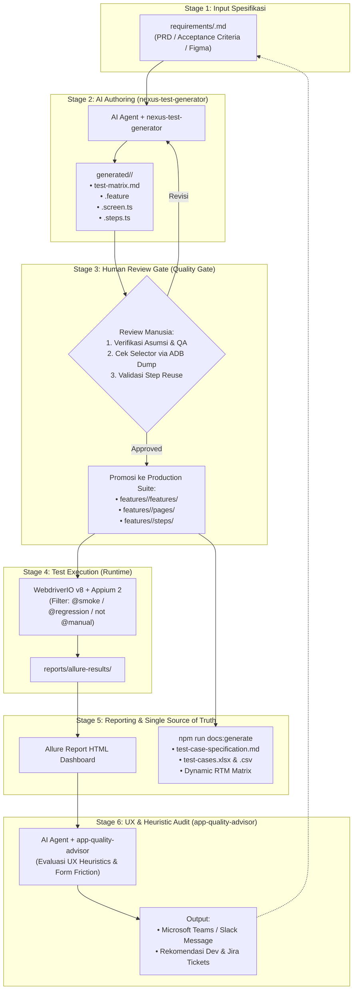

# Kotakin Mobile Automation Framework 🚀

Production-grade Mobile Test Automation Framework for **Kotakin Android App** (`com.bmolab.kotakin`), built with **WebdriverIO v8**, **Appium 2**, **Cucumber BDD**, **TypeScript**, **Allure 2 Reports**, and **AI-Driven Quality Heuristics**.

[](https://github.com/fraharjo/kotakin-mobile-automation/actions)
[-green.svg)](https://developer.android.com/)
[](https://webdriver.io/)
[](https://appium.io/)
[](https://cucumber.io/)
[](https://allurereport.org/)
[](https://opensource.org/licenses/MIT)

---

## 📑 Daftar Isi
1. [Arsitektur & Siklus Hidup Pengujian (BDD + AI Skills)](#-arsitektur--siklus-hidup-pengujian-bdd--ai-skills)
2. [Cakupan Test Suite (Test Coverage)](#-cakupan-test-suite-test-coverage)
3. [Struktur Direktori Project](#-struktur-direktori-project)
4. [Prasyarat Sistem & Konfigurasi Environment](#-prasyarat-sistem--konfigurasi-environment)
5. [Unduh File APK Kotakin (Aman & Terverifikasi)](#-unduh-file-apk-kotakin-aman--terverifikasi)
6. [Menjalankan Pengujian (Flexible Run Commands)](#-menjalankan-pengujian-flexible-run-commands)
7. [Dokumentasi Otomatis (Single Source of Truth)](#-dokumentasi-otomatis-single-source-of-truth)
8. [Pelaporan Interaktif (Allure Report)](#-pelaporan-interaktif-allure-report)
9. [Continuous Integration (GitHub Actions CI/CD)](#-continuous-integration-github-actions-cicd)
10. [Panduan Penggunaan AI Skill (Authoring & UX Audit)](#-panduan-penggunaan-ai-skill-authoring--ux-audit)

---

## 🔄 Arsitektur & Siklus Hidup Pengujian (BDD + AI Skills)

> [!IMPORTANT]
> **Pemisahan Authoring vs Runtime:** AI Skills (`nexus-test-generator` dan `app-quality-advisor`) **bukan bagian dari runtime eksekusi test**. Skill adalah instruksi kontekstual untuk AI Agent pada tahap *Authoring* (perancangan skenario) dan *Post-Execution Audit* (analisis UX). WebdriverIO & Appium hanya mengeksekusi kode yang telah melalui *Human Review Gate*.



---

## 📊 Cakupan Test Suite (Test Coverage)

Total **49 Skenario BDD** terotomatisasi secara penuh melintasi 5 modul aplikasi Kotakin:

| Modul Aplikasi | Total Skenario | Jira Key | Cakupan Pengujian |
| :--- | :---: | :---: | :--- |
| **Box Creation & Management** | 21 | `@JIRA-KTK-201` | CRUD Box, BVA batas nama (1 & 50 char), Whitespace, Sanitasi script injection, Pencarian regex, Backgrounding |
| **Item Management Inside Box** | 11 | `@JIRA-KTK-202` | Stepper quantity (+/-), Ambil foto kamera, Karakter unicode/emoji, Deskripsi panjang (250 char), Negative validation |
| **Application Settings & Localization** | 5 | `@JIRA-KTK-203` | Dual language (EN / ID), Auto-switch label dinamis, Verifikasi versi build, Backup/Restore data |
| **Onboarding & Walkthrough** | 4 | `@JIRA-KTK-204` | Multi-slide walkthrough, Skip guide, Navigasi kembali ke My Stash, Fresh app state reset |
| **Physical QR Code Scanner** | 3 | `@JIRA-KTK-205` | Viewfinder scanner, Penolakan izin kamera (*permission denied*), Navigasi kembali aman |

---

## 📁 Struktur Direktori Project

Framework ini menerapkan **Feature-First (Modular Screaming Architecture)**. Setiap modul domain (`box`, `item`, `settings`, dst.) mengelompokkan spesifikasi Gherkin, Screen Object, Step Definitions, dan PRD-nya secara kohesif:

```text
kotakin-mobile-automation/
├── .agents/skills/                 # AI Assistant Skills (Antigravity / Claude Code / Cursor)
│   ├── nexus-test-generator/       # SDET Generator: Gherkin, POM stub, Step reuse
│   └── app-quality-advisor/        # UX Heuristic Auditor: Evaluasi alur, form friction, feedback dev
├── .github/workflows/              # GitHub Actions CI/CD Workflows
│   └── test-runner.yml             # Dual-mode CI: Fast Typecheck on Push & Emulator on Demand
├── apps/                           # Lokasi penyimpanan APK (Excluded dari git)
│   └── README.md                   # Panduan unduh APK aman & verifikasi SHA-256
├── docs/                           # Dokumentasi Pengujian (Single Source of Truth)
│   ├── test-case-specification.md  # Spesifikasi 49 test cases lengkap + RTM dinamis
│   ├── test-cases.xlsx             # Export format Microsoft Excel (.xlsx)
│   └── test-cases.csv              # Export format Universal CSV (.csv)
├── features/                       # Production Test Suites (Modular per Domain)
│   ├── box/
│   │   ├── features/box.feature    # 21 Skenario BDD Box Management
│   │   ├── pages/box.screen.ts     # Screen Object Box (Inherit BaseScreen)
│   │   ├── steps/box.steps.ts      # Step Definitions Box
│   │   └── requirements/box-prd.md # Requirement acuan fitur Box
│   ├── item/                       # Modul Manajemen Item (11 Skenario)
│   ├── onboarding/                 # Modul Walkthrough (4 Skenario)
│   ├── scanner/                    # Modul QR Scanner (3 Skenario)
│   └── settings/                   # Modul Settings & i18n (5 Skenario)
├── generated/                      # Staging Area: Draf artefak AI sebelum di-review
│   └── README.md                   # Aturan promosi & anti-hallucination gate
├── requirements/                   # Input Area: Dokumen PRD / AC fitur baru untuk di-generate
│   └── README.md                   # Panduan format input untuk AI Agent
├── reports/                        # Lokasi hasil Allure (allure-results & allure-report)
├── scripts/                        # Utility & Automation Scripts
│   ├── download-apk.sh             # Script unduh APK resmi + verifikasi SHA-256
│   └── generate-docs.ts            # Script generator dokumen otomatis dari file .feature
├── shared/                         # Komponen Reusable Lintas Platform
│   ├── config/env.config.ts        # Dynamic dotenv configuration loader
│   ├── constants/i18n.ts           # Type-safe i18n dictionary (EN / ID)
│   ├── pages/base.screen.ts        # Universal Locator Engine (XPath, Accessibility ID)
│   └── steps/common.steps.ts       # Reusable step definitions (Background, Assertions)
├── wdio.android.conf.ts            # Konfigurasi Appium & Lifecycle Hooks Android
├── wdio.shared.conf.ts             # Shared WDIO config (Cucumber, Allure, Reporters)
├── .env.example                    # Template konfigurasi environment lokal
├── package.json                    # Dependensi & script eksekusi pengujian
└── tsconfig.json                   # Konfigurasi TypeScript (Strict compilation)
```

---

## 🛠️ Prasyarat Sistem & Konfigurasi Environment

### 1. Prasyarat Perangkat Lunak
* **Node.js**: v18+ atau v20 LTS (direkomendasikan)
* **Java JDK**: v11 atau v17 Temurin (`JAVA_HOME` terkonfigurasi)
* **Android SDK**: Android Studio dengan platform-tools (`adb`) & API Level 33
* **Appium 2**: Appium Server v2.5+ dengan driver `uiautomator2`

### 2. Setup Environment (`.env`)
Salin file template `.env.example` menjadi `.env` lalu sesuaikan konfigurasi emulator lokal kamu:
```bash
cp .env.example .env
```

Contoh konfigurasi `.env`:
```ini
APPIUM_HOST=127.0.0.1
APPIUM_PORT=4723
ANDROID_DEVICE_NAME=Android Emulator
ANDROID_PLATFORM_VERSION=13.0
ANDROID_APP_PATH=./apps/kotakin.apk
ANDROID_APP_ID=com.bmolab.kotakin
```

### 3. Instalasi Dependensi
```bash
npm install
```

---

## 📥 Unduh File APK Kotakin (Aman & Terverifikasi)

File APK resmi telah dipin pada rilis GitHub `v1.0.0` dan diabaikan dari riwayat Git (`apps/*.apk` ada di `.gitignore`).

### Cara Cepat (Otomatis dengan Verifikasi Checksum):
```bash
npm run apk:download
```
Script di atas akan mengunduh APK dan memvalidasi **SHA-256 Checksum**:
`8498588707f80bc4698bd5ba8591ff5cb1ba84b9dee22ee9ba9b0f6fa5188994`

---

## 🚀 Menjalankan Pengujian (Flexible Run Commands)

Eksekusi pengujian dapat difilter secara fleksibel berdasarkan tag prioritas, tag tipe pengujian, maupun spesifik per modul:

### 1. Eksekusi Berdasarkan Tag Prioritas
```bash
# Menjalankan seluruh test suite otomatis (eksklusif not @manual)
npm run test:android

# Menjalankan pengujian Smoke kritis P0 (High Priority)
npm run test:smoke

# Menjalankan seluruh pengujian Regresi P1 (Regression Suite)
npm run test:regression
```

### 2. Eksekusi Berdasarkan Modul Fitur
```bash
npm run test:feature:box         # Modul Box Management (21 skenario)
npm run test:feature:item        # Modul Item Management (11 skenario)
npm run test:feature:settings    # Modul Settings & Dual Language (5 skenario)
npm run test:feature:onboarding  # Modul Onboarding Walkthrough (4 skenario)
npm run test:feature:scanner     # Modul QR Scanner & Permission (3 skenario)
```

---

## 📑 Dokumentasi Otomatis (Single Source of Truth)

Untuk mencegah terjadinya *document drift* antara kode dan dokumentasi:
* **File `.feature` + tags Gherkin adalah SATU-SATUNYA Single Source of Truth**.
* Seluruh file dokumentasi (`.md`, `.xlsx`, `.csv`) dan matriks keterlacakan (*Requirements Traceability Matrix / RTM*) digenerate secara otomatis melalui script:

```bash
npm run docs:generate
```

Hasil generate disimpan di:
* 📄 **Markdown Specification & RTM:** [docs/test-case-specification.md](docs/test-case-specification.md)
* 📊 **Microsoft Excel:** [docs/test-cases.xlsx](docs/test-cases.xlsx)
* 📝 **Universal CSV:** [docs/test-cases.csv](docs/test-cases.csv)

---

## 📊 Pelaporan Interaktif (Allure Report)

Setelah pengujian selesai, dashboard Allure Report dapat dibuka langsung:

```bash
npm run report:open
```

Atau generate ulang laporan HTML secara manual:
```bash
npm run report:generate
```

**Fitur Dashboard Allure:**
- Ringkasan visual tingkat kelulusan skenario.
- Rincian durasi eksekusi per step Cucumber BDD.
- Lampiran tangkapan layar otomatis (*auto-screenshot on step failure*).
- Klasifikasi severity (@smoke = Critical, @bva = Normal).

---

## 🤖 Continuous Integration (GitHub Actions CI/CD)

Framework ini terintegrasi dengan GitHub Actions di [.github/workflows/test-runner.yml](.github/workflows/test-runner.yml) dengan arsitektur **Dual-Mode**:

1. **Trigger Otomatis (`push` / `pull_request`):**
   - Menjalankan **Code Quality & TypeScript Check** di runner `ubuntu-latest`.
   - Memverifikasi kompilasi kode zero-error (`tsc --noEmit`) dalam ~30 detik.
2. **Trigger Manual (*On-Demand Workflow Dispatch*):**
   - Dijalankan via menu **Actions ➡️ Kotakin Mobile E2E Automation ➡️ Run workflow**.
   - Pengguna dapat memilih fitur target (`box`, `item`, `settings`, `all`).
   - Runner `macos-latest` otomatis mengunduh APK resmi `v1.0.0`, meluncurkan Android Emulator (API 33), menjalankan pengujian, dan mengunggah **Allure Report Artifact HTML**.

---

## 🧠 Panduan Penggunaan AI Skill (Authoring & UX Audit)

Folder [.agents/skills/](.agents/skills/) berisi *custom skills* yang kompatibel dengan **Google Antigravity**, **Claude Code**, dan AI Agent modern lainnya.

### 1. Skill `nexus-test-generator` (Authoring Time)
Gunakan skill ini ketika ada fitur baru atau perubahan PRD untuk merancang skenario BDD dan Screen Object stub:

**Contoh Prompt ke Agent:**
> *"Gunakan skill nexus-test-generator untuk merancang skenario pengujian berdasarkan requirements/box-sharing.md dengan target platform Android, lalu simpan draf ke generated/box-sharing/."*

**Aturan Kerja AI Agent:**
- Dilarang mengarang selector. Buat stub selector dan tandai `// TODO: verify with dev` jika belum ada dump UI aktual.
- Wajib mengecek pustaka step yang sudah ada di `shared/steps/` sebelum membuat step baru (*Step Reuse Rule*).
- Draf wajib disimpan di `generated/` untuk menunggu *Human Review Gate*.

---

### 2. Skill `app-quality-advisor` (Post-Execution UX & Quality Audit)
Gunakan skill ini setelah menjalankan pengujian otomasi atau eksplorasi aplikasi untuk mengevaluasi *User Experience (UX)*, menemukan *anti-patterns*, dan menyusun pesan siap-kirim ke developer:

**Contoh Prompt ke Agent:**
> *"Gunakan skill app-quality-advisor untuk mengaudit alur pembuatan kotak pada Kotakin Android App. Evaluasi formulir validasi, penanganan whitespace, dan dialog konfirmasi. Buat draf pesan format Microsoft Teams untuk tim developer."*

**Pilar Evaluasi Kualitas:**
1. **Form Validation & Cognitive Friction:** Evaluasi inline error vs disruptive alert dialog.
2. **Data Integrity & Safety:** Evaluasi penanganan tombol delete, snackbar undo, dan duplikasi entitas.
3. **Empty States & First-Time Experience:** Evaluasi instruksi dan daya tarik visual pada layar kosong.
4. **Navigation Consistency & Recovery:** Evaluasi konsistensi navigasi kembali (*back button / Android gesture*).
5. **Localization & UI Adaptability:** Evaluasi kelengkapan terjemahan dan potensi teks terpotong (*text truncation*).
6. **Visual Ergonomics & Touch Targets:** Evaluasi keterbacaan kontras dan ukuran tombol (minimal 48x48 dp).
