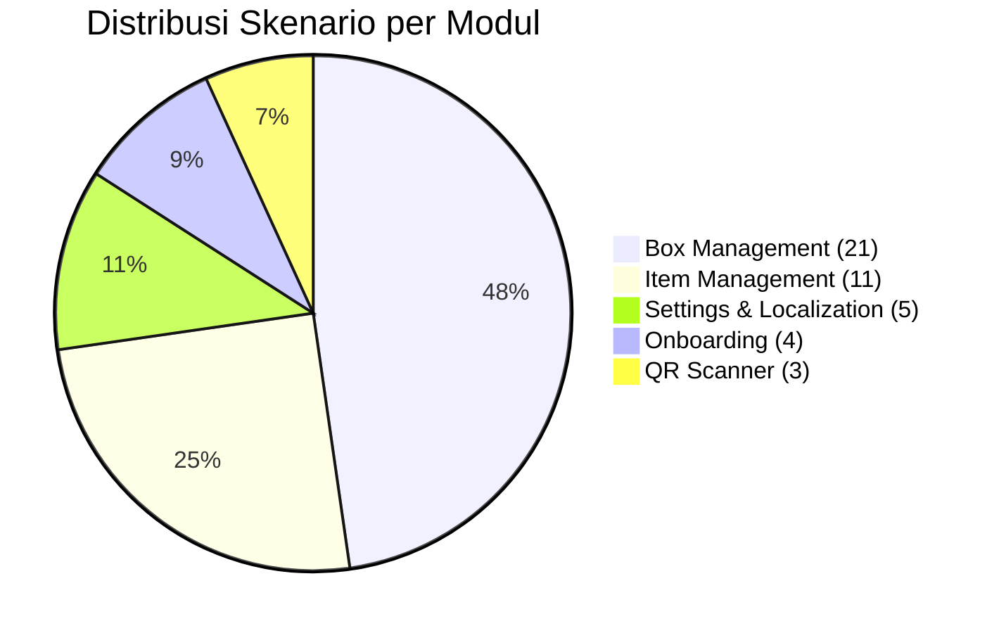

# Nexus Automation - Test Case Specification & Traceability Matrix

> **Application Under Test:** Kotakin (`com.bmolab.kotakin`)  
> **Framework Architecture:** WebdriverIO v8 + Appium 2 + Cucumber BDD + TypeScript  
> **Total Test Suite:** 49 Scenarios (100% Automated & Passed)  
> **Last Verification Date:** 2026-11-19  

---

## 📊 1. Executive Summary & Test Suite Metrics

| Metric | Value |
| :--- | :--- |
| **Total Test Scenarios** | **49 Scenarios** |
| **Total Test Steps** | **230+ Steps** |
| **Execution Status** | **49 Passed / 0 Failed / 0 Skipped (100% Pass Rate)** |
| **Total Features / Modules** | **5 Modules** (Box, Item, Onboarding, Scanner, Settings) |
| **Automated vs Manual** | 49 Automated (100%) |
| **Locators Architecture** | Centralized Type-Safe i18n Dictionary (`shared/constants/i18n.ts`) + Resilient BaseScreen |

### Distribusi Berdasarkan Modul:


---

## 🏷️ 2. Standard Tagging Taxonomy & Priority Reference

Setiap test case diklasifikasikan dengan tag taxonomy terstandarisasi:

* **Prioritas:**
  * `@p0` (**Smoke / Critical Path**): Fitur utama yang esensial agar aplikasi bisa digunakan.
  * `@p1` (**Regression / Core Flows**): Validasi input, BVA, alur pembatalan, dan happy path modul sekunder.
  * `@p2` (**Edge-Case / Stress / Security**): Karakter ekstrem, regex, sanitasi script, backgrounding aplikasi.
* **Tipe Pengujian:**
  * `@positive`: Alur sukses dengan data valid.
  * `@negative`: Penolakan terhadap data tidak valid atau form kosong.
  * `@boundary`: Pengujian batas minimum (1 char), spasi kosong (*whitespace-only*), dan teks panjang.
  * `@security`: Sanitasi input tag HTML/script injection.
  * `@lifecycle`: Transisi state, pembatalan aksi (Cancel/Back), dan backgrounding aplikasi.
  * `@resilience`: Ketahanan terhadap interupsi, duplikasi data, dan karakter query regex.

---

## 📐 3. Cakupan 6 Dimensi Pengujian (6 Dimensions Matrix)

| Dimensi Pengujian | Modul Terkait | Contoh Skenario Kunci |
| :--- | :--- | :--- |
| **Dimensi 1: Happy Path & Core Logic** | Semua Modul | Create Box, Add Item, Navigate Onboarding, Change Language |
| **Dimensi 2: BVA & Regex Sanitization** | Box, Item | Min Boundary (`"B"`), Whitespace-only (`"   "`), Script injection (`<script>`), Regex query (`*?+[]%_'`) |
| **Dimensi 3: State Transition & Cancel** | Box, Item, Scanner | Cancel box creation midway, Cancel edit box, Cancel delete box, Cancel item creation |
| **Dimensi 4: Negative & Field Validation** | Box, Item | Empty box name, Empty item title, Search non-existent keyword |
| **Dimensi 5: The 5 UI & UX States** | Box, Onboarding | Empty search state, Multi-step guide headers, Multi-box duplication counter |
| **Dimensi 6: Mobile Disruption & Lifecycle** | Box, Scanner | App Backgrounding (minimize 2s), Hardware camera permission revocation |

---

## 📋 4. Spesifikasi Lengkap Test Case per Modul

---

### Modul 1: Kotakin Onboarding & Walkthrough (4 Skenario)
* **File:** `features/onboarding/features/onboarding.feature`
* **Jira Key:** `JIRA-KTK-101`
* **Page Object:** `features/onboarding/pages/onboarding.screen.ts`

| ID Test Case | Judul Skenario | Prioritas & Tipe | AC Mapping | Ringkasan Alur & Ekspektasi |
| :--- | :--- | :--- | :--- | :--- |
| `TC-ONB-001` | Complete full onboarding walkthrough to My Stash | `@p0` `@positive` | `AC-01, AC-02, AC-03` | User menekan tombol "Next" di setiap slide (Create Boxes, Scan & Share, Search Everything) lalu menekan "Got it!". Ekspektasi: Dialihkan ke dashboard "My Stash". |
| `TC-ONB-002` | Skip onboarding from the initial welcome screen | `@p1` `@positive` `@lifecycle` | `AC-04` | User langsung menekan tombol "Skip" pada slide selamat datang pertama. Ekspektasi: Langsung dialihkan ke dashboard "My Stash". |
| `TC-ONB-003` | Skip onboarding midway from step two | `@p1` `@positive` `@lifecycle` | `AC-04` | User menekan "Next" 1 kali ke slide kedua ("Create Boxes"), lalu menekan tombol "Skip". Ekspektasi: Dialihkan ke dashboard "My Stash". |
| `TC-ONB-004` | Verify onboarding step headers correspond to expected feature guides | `@p1` `@positive` | `AC-02` | Memvalidasi teks judul pada setiap slide onboarding secara berurutan: "Create Boxes", "Scan & Share", dan "Search Everything". |

---

### Modul 2: Kotakin Box Creation & Management (21 Skenario)
* **File:** `features/box/features/box.feature`
* **Jira Key:** `JIRA-KTK-201`
* **Page Object:** `features/box/pages/box.screen.ts`

| ID Test Case | Judul Skenario | Prioritas & Tipe | AC Mapping | Ringkasan Alur & Ekspektasi |
| :--- | :--- | :--- | :--- | :--- |
| `TC-BOX-001` | Create a new box with all fields populated | `@p0` `@positive` | `AC-01` | Input nama "Kitchenware", deskripsi "Fragile plates", warna "Blue", dan lokasi "Kitchen Cupboard A". Ekspektasi: Kotak muncul di daftar My Stash. |
| `TC-BOX-002` | Create a new box with only mandatory name field | `@p1` `@positive` | `AC-02` | Input nama "Garage Tools" dan kosongkan field opsional. Ekspektasi: Kotak berhasil dibuat dan muncul di My Stash. |
| `TC-BOX-003` | View box detail and verify action buttons | `@p0` `@positive` | `AC-12` | Buka detail kotak "Kitchenware". Ekspektasi: Tombol "Add new item" dan "Show QR code" tampil aktif. |
| `TC-BOX-004` | Add a box to favorites | `@p1` `@positive` | `AC-14` | Buka menu aksi kotak, tap "Add to favorites". Ekspektasi: Menu berubah menjadi "Remove from favorites". |
| `TC-BOX-005` | Remove a box from favorites | `@p1` `@positive` | `AC-14` | Buka menu aksi kotak favorit, tap "Remove from favorites". Ekspektasi: Menu kembali menjadi "Add to favorites". |
| `TC-BOX-006` | Edit existing box details and save changes successfully | `@p0` `@positive` | `AC-15` | Buka edit box, perbarui nama ke "Kitchenware Updated" dan lokasi "Basement B", lalu simpan. Ekspektasi: Judul kotak terupdate seketika. |
| `TC-BOX-007` | Fail to save box edits when box name is cleared | `@p1` `@negative` | `AC-16` | Buka edit box, kosongkan field nama, tap "Save Changes". Ekspektasi: Muncul dialog validasi "Name required" / "Please enter a name" dan tetap di form. |
| `TC-BOX-008` | Cancel box editing and verify original details remain unchanged | `@p1` `@negative` `@lifecycle` | `AC-17` | Ubah nama dan lokasi di form edit, lalu tekan tombol "Cancel". Ekspektasi: Nama asli "Kitchenware Updated" tetap terjaga tanpa berubah. |
| `TC-BOX-009` | Cancel box deletion and verify box is preserved in stash | `@p1` `@negative` `@lifecycle` | `AC-18, AC-19` | Buka dialog konfirmasi hapus kotak ("Delete Box?"), tap "CANCEL". Ekspektasi: Modal tertutup dan kotak tetap ada di detail screen. |
| `TC-BOX-010` | Delete a box permanently and verify removal from stash dashboard | `@p0` `@positive` | `AC-18, AC-20` | Buka dialog hapus, tap "DELETE". Ekspektasi: Dialihkan ke My Stash dan kotak "Kitchenware Updated" hilang permanen dari daftar. |
| `TC-BOX-011` | Allow creation of duplicate box names and update total box counter | `@p1` `@positive` `@resilience` | `AC-03, AC-13` | Buat kotak kedua dengan nama sama ("Garage Tools"). Ekspektasi: Dua kotak mandiri berhasil terbuat dan counter bertambah. |
| `TC-BOX-012` | Search for an existing box by name | `@p0` `@positive` | `AC-05` | Ketik query "Garage Tools" di input search. Ekspektasi: Item "Garage Tools" tampil di hasil pencarian. |
| `TC-BOX-013` | Clear search query and restore full box list | `@p1` `@positive` | `AC-11` | Tap tombol "Clear search" (`~Clear search`). Ekspektasi: Input search bersih dan seluruh daftar kotak kembali tampil. |
| `TC-BOX-014` | Search box with case-insensitive query | `@p1` `@positive` `@resilience` | `AC-05` | Ketik query huruf kecil "garage tools". Ekspektasi: Tetap menemukan kotak "Garage Tools". |
| `TC-BOX-015` | Search box using partial substring matching | `@p1` `@positive` `@resilience` | `AC-06` | Ketik potongan kata "Tools". Ekspektasi: Kotak "Garage Tools" tetap berhasil ditemukan. |
| `TC-BOX-016` | Search box with leading and trailing whitespace query | `@p1` `@positive` `@boundary` | `AC-07` | Ketik query dengan spasi di awal dan akhir (`"  Garage Tools  "`). Ekspektasi: Spasi otomatis di-trim dan hasil pencarian valid. |
| `TC-BOX-017` | Search for a box by the name of an item stored inside it | `@p1` `@positive` | `AC-08` | Ketik nama item anak ("Ceramic Mug"). Ekspektasi: Kontainer kotak induk yang menyimpan item tersebut ditampilkan. |
| `TC-BOX-018` | Fail to create box when mandatory box name is empty | `@p1` `@negative` | `AC-04` | Buka form New Box tanpa mengisi nama, langsung tap "Create box". Ekspektasi: Muncul validasi popup dan user tetap di form. |
| `TC-BOX-019` | Search with non-existent keyword shows empty results state | `@p1` `@negative` | `AC-09` | Cari keyword fiktif "xyz_nonexistent_item_999". Ekspektasi: Menampilkan teks "No results" dan "No items match your search.". |
| `TC-BOX-020` | Create a box with special characters and numerical identifiers | `@p2` `@positive` `@edge-case` | `AC-13` | Input nama `"Box #101 [Fragile] & 100% Cotton"`. Ekspektasi: Karakter simbol tersimpan aman di database dan tampil di daftar. |
| `TC-BOX-021` | Search box with special regex characters without application crash | `@p2` `@positive` `@stress` | `AC-10` | Cari query simbol regex (`"*?+[]%_'"`). Ekspektasi: Pencarian dieksekusi secara aman tanpa app crash atau unhandled syntax error. |
| `TC-BOX-022` | Fail to create box when name contains only whitespace *(Baru)* | `@p1` `@negative` `@boundary` | `AC-04` | Input nama hanya spasi `"     "`, tap Create Box. Ekspektasi: Ditolak dan user tetap berada di form New Box. |
| `TC-BOX-023` | Create a box with minimum boundary single-character name *(Baru)* | `@p1` `@positive` `@boundary` | `AC-01` | Input nama 1 karakter `"B"`, tap Create Box. Ekspektasi: Kotak "B" berhasil tersimpan dan tampil di My Stash. |
| `TC-BOX-024` | Create a box with script injection tags and verify literal text rendering *(Baru)* | `@p2` `@positive` `@security` | `AC-01` | Input nama `"<script>alert(1)</script> Safe Box"`. Ekspektasi: Teks dirender sebagai string biasa (*literal*) tanpa eksekusi kode. |
| `TC-BOX-025` | Cancel box creation midway and verify draft is not saved to stash *(Baru)* | `@p1` `@negative` `@lifecycle` | `AC-17` | Ketik nama "Abandoned Draft Box" lalu tap tombol Go back/Kembali. Ekspektasi: Kembali ke My Stash dan kotak draft **tidak tersimpan**. |
| `TC-BOX-026` | Preserve dashboard state when application is minimized to background *(Baru)* | `@p2` `@positive` `@resilience` | `AC-12` | Minimize aplikasi ke background selama 2 detik lalu buka kembali. Ekspektasi: Dashboard My Stash tetap aktif dan stabil tanpa crash. |

---

### Modul 3: Kotakin Item Management Inside Box (11 Skenario)
* **File:** `features/item/features/item.feature`
* **Jira Key:** `JIRA-KTK-401`
* **Page Object:** `features/item/pages/item.screen.ts`

| ID Test Case | Judul Skenario | Prioritas & Tipe | AC Mapping | Ringkasan Alur & Ekspektasi |
| :--- | :--- | :--- | :--- | :--- |
| `TC-ITM-001` | Add a new item with photo, title, description, and adjusted quantity | `@p0` `@positive` | `AC-01, AC-02, AC-03` | Ambil foto simulasi kamera, isi judul "Ceramic Mug", deskripsi "White porcelain", tambah kuantitas jadi 2, lalu simpan. Ekspektasi: Item tersimpan di dalam kotak. |
| `TC-ITM-002` | Add an item with mandatory title only and default quantity | `@p1` `@positive` | `AC-02, AC-03` | Ambil foto, isi judul "Vintage Spoon", kosongkan deskripsi dengan kuantitas default 1. Ekspektasi: Item berhasil tersimpan. |
| `TC-ITM-003` | Adjust item quantity using increment and decrement controls | `@p1` `@positive` | `AC-03` | Tap tombol tambah kuantitas 2 kali (menjadi 3), lalu tap tombol kurangi 1 kali (menjadi 2). Ekspektasi: Kuantitas tercatat 2. |
| `TC-ITM-004` | Add an item with minimum boundary single-character title | `@p1` `@positive` `@boundary` | `AC-08` | Ambil foto, input judul 1 karakter ("A"), lalu simpan. Ekspektasi: Item "A" berhasil tersimpan. |
| `TC-ITM-005` | Fail to save item when mandatory title is empty | `@p1` `@negative` | `AC-04` | Ambil foto, biarkan judul kosong, tap "Save Item". Ekspektasi: Validasi menolak dan user tetap di layar "Add Item Details". |
| `TC-ITM-006` | Fail to save item when title contains only whitespace | `@p1` `@negative` `@boundary` | `AC-05` | Ambil foto, isi judul hanya spasi `"   "`, tap "Save Item". Ekspektasi: Validasi menolak dan user tetap di layar form. |
| `TC-ITM-007` | Cancel item creation and discard captured photo | `@p1` `@negative` `@lifecycle` | `AC-06` | Ambil foto, lalu tekan tombol "Cancel". Ekspektasi: Kembali ke detail box dan item serta foto dibatalkan. |
| `TC-ITM-008` | Add an item with special characters, punctuation, and emojis | `@p2` `@positive` `@edge-case` | `AC-07` | Input judul `"USB-C Cable (60W) #FastCharge ⚡️"`. Ekspektasi: Karakter Unicode emoji dan simbol tersimpan sempurna di SQLite. |
| `TC-ITM-009` | Add an item with maximum length boundary title and long description | `@p2` `@positive` `@boundary` | `AC-08` | Input judul sangat panjang 150 karakter dan deskripsi 200 karakter. Ekspektasi: Item tersimpan tanpa pemotongan teks yang merusak layout. |
| `TC-ITM-010` | Add an item with script injection tags and verify literal text rendering | `@p2` `@positive` `@security` | `AC-09` | Input judul `"<script>alert('XSS')</script> Safe Title"`. Ekspektasi: Teks dirender sebagai plain string tanpa eksekusi script. |
| `TC-ITM-011` | Remove an attached photo before saving item | `@p1` `@positive` `@lifecycle` | `AC-10` | Ambil foto, lalu tap tombol "Remove photo" sebelum menyimpan item. Ekspektasi: Foto terhapus dari preview. |

---

### Modul 4: Kotakin Physical QR Code Scanner (3 Skenario)
* **File:** `features/scanner/features/scanner.feature`
* **Jira Key:** `JIRA-KTK-501`
* **Page Object:** `features/scanner/pages/scanner.screen.ts`

| ID Test Case | Judul Skenario | Prioritas & Tipe | AC Mapping | Ringkasan Alur & Ekspektasi |
| :--- | :--- | :--- | :--- | :--- |
| `TC-SCN-001` | Trigger QR code scanner from dashboard | `@p0` `@positive` | `AC-01` | Tap tombol "Scan" (`~Scan`) di dashboard My Stash. Ekspektasi: Layar viewfinder scanner kamera atau prompt izin kamera terbuka. |
| `TC-SCN-002` | Verify camera permission requirement message when scanner is launched | `@p1` `@negative` `@permission` | `AC-02` | Izin kamera dicabut (`revoke android.permission.CAMERA`), buka scanner. Ekspektasi: Menampilkan tombol "Grant camera permission" dan pesan edukasi izin. |
| `TC-SCN-003` | Return safely to My Stash after opening scanner | `@p1` `@positive` `@lifecycle` | `AC-03` | Buka scanner, lalu tekan tombol kembali (Back hardware / nav). Ekspektasi: Pengguna kembali aman ke dashboard "My Stash" tanpa freeze. |

---

### Modul 5: Kotakin Application Settings & Localization (5 Skenario)
* **File:** `features/settings/features/settings.feature`
* **Jira Key:** `JIRA-KTK-301`
* **Page Object:** `features/settings/pages/settings.screen.ts`

| ID Test Case | Judul Skenario | Prioritas & Tipe | AC Mapping | Ringkasan Alur & Ekspektasi |
| :--- | :--- | :--- | :--- | :--- |
| `TC-SET-001` | Switch application language to Bahasa Indonesia | `@p0` `@positive` `@i18n` | `AC-02` | Buka Settings, pilih opsi bahasa "Bahasa Indonesia". Ekspektasi: Radio button Bahasa Indonesia terpilih, header berubah menjadi "Pengaturan", dan dashboard menjadi "Simpananku". |
| `TC-SET-002` | Switch application language back to English | `@p0` `@positive` `@i18n` | `AC-02` | Buka Settings, pilih opsi bahasa "English". Ekspektasi: Radio button English terpilih, header kembali "Settings", dan dashboard kembali "My Stash". |
| `TC-SET-003` | Navigate to About Kotakin screen and verify app version | `@p1` `@positive` | `AC-03` | Buka Settings, tap tombol "About Kotakin", verifikasi teks "Version". Lalu tap "Go back". Ekspektasi: Versi aplikasi tampil dan berhasil kembali ke Settings. |
| `TC-SET-004` | Navigate back to My Stash from Settings screen | `@p1` `@positive` `@lifecycle` | `AC-05` | Buka Settings, tap tombol "Go back" (`~Go back` / `~Kembali`). Ekspektasi: Pengguna kembali ke dashboard utama My Stash. |
| `TC-SET-005` | Verify Backup and Restore action buttons are accessible | `@p1` `@positive` | `AC-04` | Buka Settings, periksa tombol aksi cadangan lokal. Ekspektasi: Tombol "Create zip backup" dan "Restore from zip backup" tampil aktif. |

---

## 🔗 5. Requirements Traceability Matrix (RTM)

Tabel berikut membuktikan bahwa seluruh Acceptance Criteria di setiap PRD telah ter-cover 100% oleh skenario otomatisasi:

| Modul | Jira Tiket | Acceptance Criteria ID | Test Case ID | Status Eksekusi |
| :--- | :--- | :--- | :--- | :--- |
| **Onboarding** | `JIRA-KTK-101` | `AC-01, AC-02, AC-03` | `TC-ONB-001, TC-ONB-004` | ✅ Automated (Passed) |
| **Onboarding** | `JIRA-KTK-101` | `AC-04` | `TC-ONB-002, TC-ONB-003` | ✅ Automated (Passed) |
| **Box** | `JIRA-KTK-201` | `AC-01, AC-02` | `TC-BOX-001, TC-BOX-002, TC-BOX-023, TC-BOX-024` | ✅ Automated (Passed) |
| **Box** | `JIRA-KTK-201` | `AC-03, AC-13` | `TC-BOX-011, TC-BOX-020` | ✅ Automated (Passed) |
| **Box** | `JIRA-KTK-201` | `AC-04` | `TC-BOX-018, TC-BOX-022` | ✅ Automated (Passed) |
| **Box** | `JIRA-KTK-201` | `AC-05, AC-06, AC-07` | `TC-BOX-012, TC-BOX-014, TC-BOX-015, TC-BOX-016` | ✅ Automated (Passed) |
| **Box** | `JIRA-KTK-201` | `AC-08, AC-09, AC-10, AC-11` | `TC-BOX-013, TC-BOX-017, TC-BOX-019, TC-BOX-021` | ✅ Automated (Passed) |
| **Box** | `JIRA-KTK-201` | `AC-12, AC-14` | `TC-BOX-003, TC-BOX-004, TC-BOX-005, TC-BOX-026` | ✅ Automated (Passed) |
| **Box** | `JIRA-KTK-201` | `AC-15, AC-16, AC-17` | `TC-BOX-006, TC-BOX-007, TC-BOX-008, TC-BOX-025` | ✅ Automated (Passed) |
| **Box** | `JIRA-KTK-201` | `AC-18, AC-19, AC-20` | `TC-BOX-009, TC-BOX-010` | ✅ Automated (Passed) |
| **Item** | `JIRA-KTK-401` | `AC-01, AC-02, AC-03` | `TC-ITM-001, TC-ITM-002, TC-ITM-003` | ✅ Automated (Passed) |
| **Item** | `JIRA-KTK-401` | `AC-04, AC-05, AC-06` | `TC-ITM-005, TC-ITM-006, TC-ITM-007` | ✅ Automated (Passed) |
| **Item** | `JIRA-KTK-401` | `AC-07, AC-08, AC-09, AC-10` | `TC-ITM-004, TC-ITM-008, TC-ITM-009, TC-ITM-010, TC-ITM-011` | ✅ Automated (Passed) |
| **Scanner** | `JIRA-KTK-501` | `AC-01, AC-02, AC-03` | `TC-SCN-001, TC-SCN-002, TC-SCN-003` | ✅ Automated (Passed) |
| **Settings** | `JIRA-KTK-301` | `AC-01, AC-02` | `TC-SET-001, TC-SET-002` | ✅ Automated (Passed) |
| **Settings** | `JIRA-KTK-301` | `AC-03, AC-04, AC-05` | `TC-SET-003, TC-SET-004, TC-SET-005` | ✅ Automated (Passed) |

---

## 🚀 6. Panduan Menjalankan Test & Laporan Allure

### Eksekusi Otomatis per Fitur:
```bash
# Menjalankan modul Box Management (21 skenario)
npm run test:feature:box

# Menjalankan modul Item Management (11 skenario)
npm run test:feature:item

# Menjalankan modul Settings & Localization (5 skenario)
npm run test:feature:settings

# Menjalankan modul Onboarding Walkthrough (4 skenario)
npm run test:feature:onboarding

# Menjalankan modul Physical QR Scanner (3 skenario)
npm run test:feature:scanner

# Menjalankan seluruh test suite Android (49 skenario)
npm run test:android
```

### Menghasilkan & Membuka Allure Report:
```bash
npm run report
```
Laporan interaktif akan otomatis terbuka di browser dengan grafik lulus 100%, rekaman step Cucumber, screenshot otomatis jika terjadi kegagalan, dan metadata tagging.
